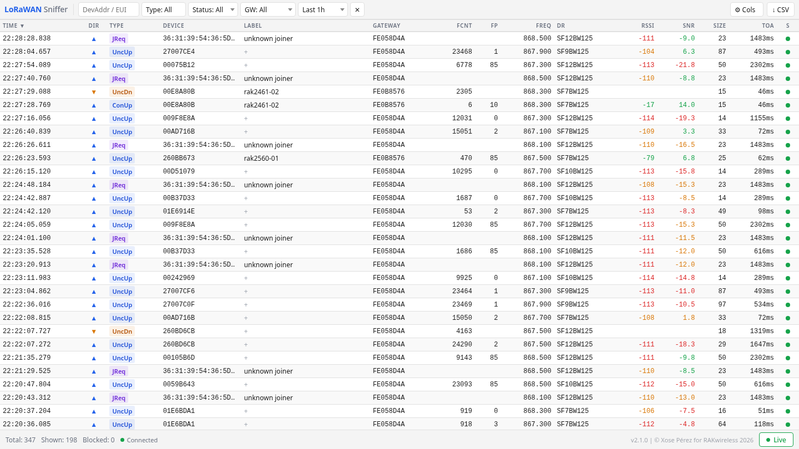

# LoRaWAN Packet Sniffer v2

A transparent MITM monitoring proxy for LoRaWAN gateways.

Sits between one or more gateways and a LoRaWAN Network Server (LNS), capturing and decoding all uplinks and downlinks in real time, with an optional selective message-blocking engine. It can also run without any LNS, just recording what the gateways send.

Version 2 is a rewrite in Rust. The original version 1 (v0.x releases) lives on the [`v1` branch](https://github.com/xoseperez/lorawan-packet-sniffer/tree/v1).



## Features

- **Dual-protocol support** — Semtech UDP Packet Forwarder and ChirpStack Concentratord (ZMQ/Protobuf)
- **Full MITM proxy** — captures both uplinks and downlinks without modifying them
- **Multiple gateways** — one sniffer instance can sit in front of an LNS serving a fleet of Semtech UDP gateways; every uplink, downlink and ACK reaches the right gateway, and the LNS sees each gateway as its own UDP peer
- **Listen mode** — no LNS needed: the sniffer records what any number of gateways send (optionally acknowledging them) and forwards nothing
- **Rich message metadata** — every record carries the gateway EUI, plus JoinEUI and DevNonce on join requests and the FCtrl flags (ADR, ADRACKReq, ACK, ClassB / FPending) and FOptsLen on data frames
- **Selective blocking** — block messages by MType, direction and, optionally, gateway; optional stealth mode (suppresses ACKs)
- **Malformed-frame detection** — frames that cannot be valid LoRaWAN (CRC failed, bad header, wrong length) are marked with the reason, carry no made-up DevAddr or DevEUI, and are hidden in the WebUI until you ask for them; forwarding is never affected
- **MQTT publishing** — optionally publish every captured message as JSON to an MQTT broker over TCP or TLS (including mutual TLS), with a configurable topic template
- **Self-forwarding protection** — refuses to start with an upstream that is its own port, and cuts any packet loop that still happens at runtime
- **Persistent storage** — SQLite database with configurable retention; databases from earlier versions are upgraded in place
- **Real-time WebUI** — React 19 SPA with WebSocket feed, live/pause toggle, filters that search the database (device or label, gateway, MType, status, time range), sortable table, column visibility, color-coded signal quality (SNR thresholds are spreading-factor-aware), dark/light theme, CSV export
- **History from the database** — a time range, or one selected day, loads the newest 5,000 matching records from the database, with the exact count of what matches; live records are merged in, and every reconnect reloads the range so the table has no hole (see [WebUI history](#webui-history))
- **Device labels** — give a device a name from the WebUI ("Qingping T&H Havana" instead of `00E8A80B`); the label is stored in the database, shown on every row of that device, found by the device filter, included in the CSV export, and updated in every open WebUI at once
- **Optional login** — one shared token in `sniffer.toml` puts a login page in front of the WebUI and the whole API; a browser stays logged in until it is closed, scripts send the token as a Bearer header, and a limit on wrong tokens keeps guessing out (see [WebUI login](#webui-login)). Off by default
- **Single binary** — React frontend is embedded at compile time; no separate web server needed
- **Self-contained** — ZeroMQ and SQLite are compiled into the binary; no runtime system dependencies

## Quick Start (Docker)

```bash
# Copy and edit the example config
cp sniffer.toml my-sniffer.toml

# Build the image
docker build -t lorawan-sniffer .

# Run with Docker Compose
docker compose up -d

# Open the WebUI
xdg-open http://localhost:8888
```

Point your LoRaWAN gateway at `<host>:1700` instead of the LNS directly. Set `GATEWAY_UDP_UPSTREAM_SERVER` to your LNS to forward the traffic; leave it unset to run in [listen mode](#listen-mode-no-lns) instead.

The WebUI asks for nothing unless you turn on the [login](#webui-login) (`SNIFFER_API_LOGIN` and `SNIFFER_API_TOKEN`).

## Install as a service (bare metal)

Each release has an archive for x86_64 and one for aarch64 (arm64) Linux, holding the static binary, a systemd service and an install script. This suits running the sniffer on the same machine as the LNS. Pick the archive that matches `uname -m` on the target:

```bash
VERSION=2.1.0
ARCH=$(uname -m)    # x86_64 or aarch64
BASE=https://github.com/xoseperez/lorawan-packet-sniffer/releases/download/v$VERSION
curl -LO $BASE/lorawan-sniffer-$VERSION-linux-$ARCH.tar.gz
curl -LO $BASE/SHA256SUMS
sha256sum --check --ignore-missing SHA256SUMS

tar xzf lorawan-sniffer-$VERSION-linux-$ARCH.tar.gz
cd lorawan-sniffer-$VERSION-linux-$ARCH
sudo ./install.sh
```

`make dist` builds the same archives locally, in `dist/`.

`install.sh` puts the files in place and reloads systemd; it never starts or restarts the service:

| Path | Contents |
|---|---|
| `/usr/local/bin/lorawan-sniffer` | the program |
| `/etc/systemd/system/lorawan-sniffer.service` | the service |
| `/etc/lorawan-sniffer/sniffer.toml` | configuration; an existing one is kept, and the new template is written next to it as `sniffer.toml.new`. A new `sniffer.toml` and the `sniffer.toml.new` template each carry a freshly generated [login token](#where-the-generated-token-is); the login stays off until you turn it on |
| `/etc/lorawan-sniffer/sniffer.env` | secrets, readable by root only; kept on upgrade |
| `/var/lib/lorawan-sniffer/` | the database, created by the service |

Review the configuration, then start the service:

```bash
sudoedit /etc/lorawan-sniffer/sniffer.toml
sudo systemctl enable --now lorawan-sniffer
journalctl -u lorawan-sniffer -f
```

The WebUI is then at `http://<host>:8888`. Unless you turn on the [login](#webui-login) it asks for nothing, so anyone who can reach that port sees all captured traffic and can edit [device labels](#device-labels). On a machine reachable from untrusted networks, turn the login on (a fresh install has already put a generated token in `sniffer.toml`: set `login = true` in `[sniffer.api]` and restart), or set `bind = "127.0.0.1:8888"` and use an SSH tunnel or a reverse proxy. Reach it by IP address or `localhost`; to use a host name, list the name in `allowed_hosts` first (see [Host check](#host-check)).

### Next to the LNS on the same machine

The installed configuration is set up for this without touching the LNS. The LNS keeps UDP port 1700; the sniffer listens on 1702 and forwards to `127.0.0.1:1700`:

```
gateway ──▶ host:1702 (sniffer) ──▶ 127.0.0.1:1700 (LNS)
```

Point a gateway's packet forwarder at port 1702 to sniff it; gateways still sending to 1700 reach the LNS directly, as before.

To sniff every gateway without reconfiguring any of them, swap the ports: move the LNS's UDP listener to a loopback port (for ChirpStack Gateway Bridge, `udp_bind = "127.0.0.1:1701"` in `[backend.semtech_udp]`), then set `bind = "0.0.0.0:1700"` in `[gateway.udp.downstream]` and `port = 1701` in `[gateway.udp.upstream]`. Either way the LNS sees each gateway as its own peer, coming from `127.0.0.1` with a port of its own.

### Secrets

`sniffer.toml` is readable by every local user. Put the MQTT password in `/etc/lorawan-sniffer/sniffer.env` instead, which systemd reads as root before starting the sniffer:

```bash
# /etc/lorawan-sniffer/sniffer.env (mode 0600)
MQTT_PASSWORD='p@ss"word\with$symbols'
```

and refer to it from `sniffer.toml` as `password = "$MQTT_PASSWORD"`. Single-quoted values are taken literally.

The same goes for the [login token](#who-can-read-the-token): `install.sh` writes a generated one into `sniffer.toml`, where every local user can read it, and `sniffer.env` is the place for it on a host with local users you do not trust.

### About the service

- It runs as an unprivileged user that systemd creates on the fly, inside a sandbox: it can write only to `/var/lib/lorawan-sniffer`, holds no capabilities and sees a private `/tmp`. Ports below 1024 are therefore not available.
- `systemctl stop` (SIGTERM) makes the sniffer save the records still queued for the database and exit, within a few seconds.
- It is restarted automatically if it crashes.
- **Concentratord mode** needs Concentratord's ZeroMQ sockets in the real `/tmp` and permission to open them. Install the override shipped in the archive: `sudo mkdir -p /etc/systemd/system/lorawan-sniffer.service.d && sudo cp concentratord.conf /etc/systemd/system/lorawan-sniffer.service.d/`, then `sudo systemctl daemon-reload && sudo systemctl restart lorawan-sniffer`. It runs the sniffer as root with a shared `/tmp`.

### Upgrade and removal

```bash
# Upgrade: unpack the new archive, then
sudo ./install.sh
sudo systemctl restart lorawan-sniffer
diff /etc/lorawan-sniffer/sniffer.toml /etc/lorawan-sniffer/sniffer.toml.new   # new options, if any

# Remove the program and the service (configuration and database are kept)
sudo ./install.sh --uninstall
```

`sniffer.toml.new` holds a login token generated for that run, so the `diff` always shows the `token` line as different; it is there to be copied if you [turn the login on](#where-the-generated-token-is). Your `sniffer.toml` is never edited.

## Deployment (Semtech UDP)

There are two ways to place the sniffer between the gateways and the LNS, plus listen mode when there is no LNS at all. In every case the gateway's packet forwarder is configured to send to the sniffer's UDP port instead of the LNS.

### On the gateway (single gateway)

Run the sniffer next to the packet forwarder on the gateway itself. Point the forwarder at the sniffer (for example `127.0.0.1:1700`) and set the sniffer's upstream to the real LNS. Nothing changes for the LNS.

### In front of the LNS (many gateways)

Run the sniffer on or near the LNS and point every gateway at the sniffer's address instead of the LNS. In proxy mode the sniffer keeps one session per gateway EUI, and each session owns its own UDP socket towards the LNS. The LNS therefore sees every gateway as a separate peer (its own source port), exactly as if the gateways talked to it directly, and can address downlinks to each of them.

- Packets are forwarded byte for byte; the sniffer never rewrites tokens. PUSH_ACK, PULL_ACK and PULL_RESP go back to the gateway the LNS was talking to, even when two gateways use the same token at the same time.
- A session follows the gateway's EUI, not its address: a gateway that changes IP address or port (NAT, restart) keeps its session and its LNS-side peer.
- A gateway that has been silent for `session_timeout` (default `5m`) has its upstream socket and routing state released, and gets a fresh session when it sends again. Packet forwarders send a keep-alive every 10 seconds by default, so a live gateway never reaches the timeout.
- At most `max_gateways` (default `100`) gateways are handled at once. Packets from new gateways beyond the limit are dropped with a rate-limited warning; the gateways already connected are not affected.

Concentratord mode always talks to the one gateway it runs on; its gateway ID is recorded on every message and gateway-specific blocking rules apply to it.

### Listen mode (no LNS)

Set `mode = "listen"` in `[gateway.udp]` (the Docker image does this by itself when `GATEWAY_UDP_UPSTREAM_SERVER` is not set). The sniffer records, broadcasts and publishes whatever any number of gateways send, and sends nothing upstream.

- By default it answers each PUSH_DATA with a PUSH_ACK and each PULL_DATA with a PULL_ACK, so the gateways see a healthy link. Set `listen_acks = false` to stay completely silent. It never sends downlinks.
- Captured messages have the status `Captured` (a neutral grey dot in the WebUI, with its own status filter).
- Blocking rules have no effect in listen mode, since nothing is forwarded; a warning is logged at startup if any are configured.

### Self-forwarding protection

In proxy mode the sniffer refuses to start if the upstream address is its own gateway-facing port, reached through any of the machine's addresses (loopback or not), and says why. If a loop happens anyway, for example through NAT or Docker port forwarding, the looped packets are detected at runtime, dropped with an error log, and never recorded, published or forwarded again.

### Tested with

Multi-gateway routing follows the behavior of the Semtech reference packet forwarder (PUSH_DATA sent from one socket, PULL_DATA and TX_ACK from another); other packet forwarders have not been tested.

<!-- Gateway models, firmware and LNS used in field validation go here. -->

## Building from Source

**Requirements:** Rust (stable), Node.js 20+, npm

```bash
# Build WebUI + Rust binary (debug)
make build-full

# Run with example config
make run
```

## Cross-Compilation

Cross-compiled release binaries are produced with [`cross`](https://github.com/cross-rs/cross).

```bash
# Install cross (once)
cargo install cross --git https://github.com/cross-rs/cross

# Build for both targets (builds WebUI once first)
make build-all

# Or individually:
make build-x86_64-unknown-linux-musl
make build-aarch64-unknown-linux-musl
```

Output: `target/<triple>/release/lorawan-sniffer`

Binaries are statically linked against musl libc. ZeroMQ and SQLite are compiled from source and embedded; the binary has no runtime dependencies.

```bash
# Release archives for both targets, plus SHA256SUMS, in dist/
make dist
```

`make dist` builds the WebUI and both binaries, then packs each binary with the systemd service, the install script and the configuration templates from `packaging/` (see [Install as a service](#install-as-a-service-bare-metal)). The archives are reproducible: building the same commit twice gives identical files.

## Docker

```bash
# Build an image from source (x86_64 only; needs only Docker)
make docker-build

# Build the release image for the host architecture from the dist/ binaries
make docker-build-release

# Build and push the multi-arch release image (amd64 + arm64) to a registry
DOCKER_IMAGE=ghcr.io/yourname/lorawan-sniffer DOCKER_TAG=latest make docker-buildx
```

The release image (`docker/Dockerfile.release`) contains the same binaries as the release archives. It compiles nothing, so building the arm64 image on an x86_64 machine needs no emulation. `docker stop` stops the sniffer cleanly within a second or so.

## Releases

Releases are built by GitHub Actions (`.github/workflows/release.yml`) when a version tag is pushed.

1. Set the new version in `lorawan-sniffer/Cargo.toml`, run `cargo check` so `Cargo.lock` follows, and run `npm version X.Y.Z --no-git-tag-version` in `webui/` (updates `package.json` and `package-lock.json`).
2. In `CHANGELOG.md`, move the `[Unreleased]` entries into a new `## [X.Y.Z] - YYYY-MM-DD` section, keep an empty `[Unreleased]` above it, and update the link references at the bottom.
3. Commit and push to `master`, then tag that commit and push the tag: `git tag vX.Y.Z && git push origin vX.Y.Z`

The workflow refuses to release if the tag is not exactly `v` plus the version in `Cargo.toml`, if the tagged commit is not on `master`, if `CHANGELOG.md` has no section for the version, or if the tests fail. It then publishes:

- a GitHub Release `vX.Y.Z` whose notes are the changelog section, with `lorawan-sniffer-X.Y.Z-linux-x86_64.tar.gz`, `lorawan-sniffer-X.Y.Z-linux-aarch64.tar.gz` and `SHA256SUMS`;
- the multi-arch (amd64 + arm64) image `ghcr.io/xoseperez/lorawan-packet-sniffer` tagged `X.Y.Z`, `X.Y` and `latest`.

A version with a suffix (`2.2.0-rc.1`) is published as a pre-release and only gets its full-version image tag. To test the pipeline without releasing anything, run the workflow by hand (Actions > Release > Run workflow): it builds and packages everything, builds the image without pushing it, and keeps the archives as the `release-files` artifact of the run.

## Docker Environment Variables

When running with Docker, the sniffer can be configured entirely via environment variables in your `docker-compose.yml` (or `docker run -e`). All variables have sensible defaults, so the service starts even if none are set.

| Variable | Description | Default |
|---|---|---|
| `SNIFFER_LOG_LEVEL` | Log verbosity (`TRACE`, `DEBUG`, `INFO`, `WARN`, `ERROR`) | `INFO` |
| `SNIFFER_API_BIND` | Address and port for the WebUI / HTTP API | `0.0.0.0:8888` |
| `SNIFFER_API_ALLOWED_HOSTS` | Comma-separated host names (not IP addresses, which always work) the WebUI and API may be reached by, e.g. `sniffer.example.com,sniffer.lan`; see [Host check](#host-check) | empty |
| `SNIFFER_API_LOGIN` | `true` asks for the token before the WebUI and the API answer anything; see [WebUI login](#webui-login) | `false` |
| `SNIFFER_API_TOKEN` | The login token: at least 32 hexadecimal characters, generated (`openssl rand -hex 16`). Used only when `SNIFFER_API_LOGIN` is `true`; the sniffer then refuses to start without a valid one | empty |
| `SNIFFER_DATABASE_PATH` | Path to the SQLite database file | `/var/lib/lorawan-sniffer/sniffer.db` |
| `SNIFFER_DATABASE_RETENTION` | How long to keep messages (e.g. `30days`, `12hours`) | `30days` |
| `GATEWAY_PROTOCOL` | Backend protocol (`udp` or `concentratord`) | `udp` |
| `GATEWAY_UDP_DOWNSTREAM_BIND` | Address the gateway sends packets to | `0.0.0.0:1700` |
| `GATEWAY_UDP_MODE` | UDP mode: `proxy` (forward to the LNS) or `listen` (no LNS, record only) | `listen` when `GATEWAY_UDP_UPSTREAM_SERVER` is unset or empty, otherwise `proxy` |
| `GATEWAY_UDP_LISTEN_ACKS` | Listen mode only: answer PUSH_DATA / PULL_DATA with PUSH_ACK / PULL_ACK | `true` |
| `GATEWAY_UDP_SESSION_TIMEOUT` | Release a gateway's session after it has been silent this long | `5m` |
| `GATEWAY_UDP_MAX_GATEWAYS` | Maximum number of gateways handled at the same time | `100` |
| `GATEWAY_UDP_UPSTREAM_SERVER` | LNS hostname or IP to forward packets to. Leave it unset to run in listen mode | `localhost` (only used in proxy mode) |
| `GATEWAY_UDP_UPSTREAM_PORT` | LNS UDP port | `1700` |
| `GATEWAY_CONCENTRATORD_DOWNSTREAM_EVENT_URL` | ZMQ URL to subscribe to concentratord events | `ipc:///tmp/concentratord_event` |
| `GATEWAY_CONCENTRATORD_DOWNSTREAM_COMMAND_URL` | ZMQ URL to send commands to concentratord | `ipc:///tmp/concentratord_command` |
| `GATEWAY_CONCENTRATORD_UPSTREAM_EVENT_BIND` | ZMQ URL to publish events to upstream consumers | `ipc:///tmp/sniffer_event` |
| `GATEWAY_CONCENTRATORD_UPSTREAM_COMMAND_BIND` | ZMQ URL to accept commands from upstream consumers | `ipc:///tmp/sniffer_command` |
| `SNIFFER_MQTT_ENABLED` | Publish captured messages to an MQTT broker | `false` |
| `SNIFFER_MQTT_SERVER` | Broker hostname or IP | `localhost` |
| `SNIFFER_MQTT_PORT` | Broker port | `1883` |
| `SNIFFER_MQTT_TLS` | Connect over TLS | `false` |
| `SNIFFER_MQTT_CA_FILE` | PEM file with the CA(s) used to verify the broker; empty = bundled public CA roots | empty |
| `SNIFFER_MQTT_CLIENT_CERT_FILE` | PEM client certificate (mutual TLS; set together with the key) | empty |
| `SNIFFER_MQTT_CLIENT_KEY_FILE` | PEM client private key (mutual TLS; set together with the certificate) | empty |
| `SNIFFER_MQTT_CLIENT_ID` | MQTT client identifier | `lorawan-sniffer` |
| `SNIFFER_MQTT_USERNAME` | Broker username | empty |
| `SNIFFER_MQTT_PASSWORD` | Broker password | empty |
| `SNIFFER_MQTT_TOPIC` | Topic template (see [MQTT publishing](#mqtt-publishing)) | `lorawan-sniffer/{gateway_eui}/{direction}/{mtype}` |
| `SNIFFER_MQTT_QOS` | MQTT QoS: `0`, `1` or `2` | `0` |

You only need to set the variables relevant to your chosen protocol. For example, a minimal UDP setup:

```yaml
environment:
  GATEWAY_PROTOCOL: "udp"
  GATEWAY_UDP_UPSTREAM_SERVER: "10.0.0.1"
  GATEWAY_UDP_UPSTREAM_PORT: "1700"
```

Without `GATEWAY_UDP_UPSTREAM_SERVER` the image starts in listen mode, recording what the gateways send and forwarding nothing:

```yaml
environment:
  GATEWAY_PROTOCOL: "udp"
```

Values from environment variables are inserted into the configuration literally, so a password (or any other value) may contain any character, including `"`, `\` and `$`.

To use custom filter rules or advanced options not covered by these variables, volume-mount a full TOML config file to `/etc/lorawan-sniffer/sniffer.toml` (this overrides the built-in template).

## Configuration

The sniffer is configured via a TOML file. Run `lorawan-sniffer configfile` to print an annotated template.

```toml
[sniffer]
  log_level     = "INFO"   # TRACE | DEBUG | INFO | WARN | ERROR
  log_to_syslog = false

[sniffer.api]
  bind = "0.0.0.0:8888"
  # cors_origins = ["https://example.com"]   # default: only the sniffer's own WebUI
  # allowed_hosts = ["sniffer.example.com"]  # host names the WebUI may be reached by;
                                             # IP addresses and localhost always work
  login = false                              # true: the WebUI and API ask for the token below
  token = ""                                 # a generated token of 32+ hex characters, needed
                                             # when login = true (see "WebUI login")

[sniffer.database]
  path      = "/var/lib/lorawan-sniffer/sniffer.db"
  retention = "30days"

[gateway]
  protocol = "udp"   # "udp" | "concentratord"

# --- UDP Packet Forwarder mode ---
[gateway.udp]
  mode            = "proxy"   # "proxy" | "listen" (no LNS, record only)
  listen_acks     = true      # listen mode: answer PUSH_DATA / PULL_DATA with ACKs
  session_timeout = "5m"      # release a gateway that has been silent this long
  max_gateways    = 100       # maximum number of gateways at once

[gateway.udp.downstream]
  bind = "0.0.0.0:1700"   # gateways send packets here

[gateway.udp.upstream]    # proxy mode only
  server = "localhost"
  port   = 1700            # real LNS address (must not be the sniffer's own port)

# --- Optional blocking rules (first match wins; no rules = forward everything) ---
# [[filters]]
#   name         = "Block confirmed uplinks"
#   enabled      = true
#   direction    = "up"               # "up" | "down" | "both"
#   suppress_ack = false              # true = stealth (suppress PUSH_ACK / PULL_ACK)
#   mtype        = ["ConfirmedDataUp"]
#   gateways     = ["AA:BB:CC:DD:00:11:22:33"]   # optional: only these gateways

# --- Optional MQTT publishing (disabled by default) ---
# [sniffer.mqtt]
#   enabled = true
#   server  = "localhost"
#   port    = 1883
#   topic   = "lorawan-sniffer/{gateway_eui}/{direction}/{mtype}"
```

See `sniffer.toml` for the full example including Concentratord IPC configuration and every MQTT key.

Configuration files written for earlier versions keep working unchanged: every new setting has a default, and the default mode is `proxy`.

### UDP settings

All keys live in `[gateway.udp]` and apply to the Semtech UDP backend.

| Key | Default | Description |
|---|---|---|
| `mode` | `"proxy"` | `"proxy"` forwards between the gateways and the LNS in `[gateway.udp.upstream]`; `"listen"` only records (see [Listen mode](#listen-mode-no-lns)) |
| `listen_acks` | `true` | Listen mode only: answer PUSH_DATA with PUSH_ACK and PULL_DATA with PULL_ACK. `false` = stay silent |
| `session_timeout` | `"5m"` | Idle time after which a gateway's session (upstream socket and routing state) is released |
| `max_gateways` | `100` | Maximum number of gateways handled at once (at least 1), in both modes |

### Blocking rules

Filter rules are evaluated in order; the first matching enabled rule wins. A packet with no matching rule is forwarded transparently.

| Field | Type | Description |
|---|---|---|
| `name` | string | Human-readable label shown in logs and the WebUI |
| `enabled` | bool | Toggle without removing the rule |
| `direction` | `"up"` \| `"down"` \| `"both"` | Which direction to match |
| `mtype` | string[] | LoRaWAN MTypes to match (empty = match all). A rule with a list never matches a [malformed frame](#malformed-frames) |
| `suppress_ack` | bool | Also suppress protocol-level ACKs (stealth mode) |
| `gateways` | string[] | Optional. Gateway EUIs the rule is limited to (empty or omitted = all gateways) |

Valid MType values: `JoinRequest`, `JoinAccept`, `UnconfirmedDataUp`, `UnconfirmedDataDown`, `ConfirmedDataUp`, `ConfirmedDataDown`, `RejoinRequest`, `Proprietary`.

A rule with a `gateways` list only matches messages received from, or addressed to, one of those gateways, so you can block traffic through one gateway and leave the others alone. EUIs are accepted with or without colons or dashes, in any case (`AA:BB:CC:DD:00:11:22:33`, `aabbccdd00112233`); an invalid EUI stops the sniffer at startup, naming the rule. A message whose gateway is unknown never matches a rule that lists gateways. Rules have no effect in UDP listen mode.

A rule that lists `mtype` values never matches a [malformed frame](#malformed-frames), because the type of such a frame is only its first byte read as a header, which means nothing for noise. Rules without an `mtype` list (direction and gateway only) still match malformed frames.

## MQTT publishing

When enabled, every captured message (both directions, forwarded or blocked, and in listen mode as well) is also published to an MQTT broker as JSON, with the same fields as a record from `/api/messages`. It works with both gateway protocols and is disabled by default.

```toml
[sniffer.mqtt]
  enabled          = false
  server           = "localhost"
  port             = 1883
  tls              = false
  ca_file          = ""
  client_cert_file = ""
  client_key_file  = ""
  client_id        = "lorawan-sniffer"
  username         = ""
  password         = ""
  topic            = "lorawan-sniffer/{gateway_eui}/{direction}/{mtype}"
  qos              = 0
```

| Key | Default | Description |
|---|---|---|
| `enabled` | `false` | Turn publishing on |
| `server`, `port` | `"localhost"`, `1883` | Broker address |
| `tls` | `false` | Connect over TLS |
| `ca_file` | `""` | PEM file with the CA certificate(s) used to verify the broker. Empty = the public CA roots bundled in the binary. When set, it replaces them |
| `client_cert_file`, `client_key_file` | `""` | PEM client certificate and private key for mutual TLS. Set both or neither |
| `client_id` | `"lorawan-sniffer"` | MQTT client identifier |
| `username`, `password` | `""` | Optional credentials. Neither is ever written to the logs |
| `topic` | `"lorawan-sniffer/{gateway_eui}/{direction}/{mtype}"` | Topic template |
| `qos` | `0` | `0`, `1` or `2` |

**Topic template.** These placeholders are replaced for every message:

| Placeholder | Value |
|---|---|
| `{gateway_eui}` | Gateway EUI, e.g. `AA:BB:CC:DD:00:11:22:33` |
| `{direction}` | `up` or `down` |
| `{mtype}` | Message type, e.g. `JoinRequest` |
| `{status}` | `Forwarded`, `Blocked` or `Captured` |
| `{dev_addr}` | Device address |
| `{dev_eui}` | Device EUI |

A value the message does not have (a DevAddr on a join request, for example) is replaced by `unknown`. A template without placeholders sends everything to one topic. An unknown placeholder or an MQTT wildcard (`+` or `#`) is a startup error, as are a QoS outside 0–2, an unreadable certificate or key file with TLS on, and a client certificate without its key (or the other way round).

**TLS.** Set `tls = true`. The broker certificate is always verified: against the bundled public CA roots by default, or against `ca_file` instead, which is what a broker with a private CA needs. Setting `client_cert_file` and `client_key_file` enables mutual TLS. There is no option to skip verification.

**Delivery.** Publishing is best effort and never slows down forwarding. Each record is handed to the MQTT client at most once; while the broker is connected and keeping up, it reaches the broker exactly once. When the broker is unreachable or too slow, the records that cannot be sent are dropped and counted instead of being queued without limit, a rate-limited warning is logged, and the sniffer keeps forwarding and reconnects on its own. The sniffer starts normally when the broker is down. Every connection uses a clean MQTT session, so nothing is replayed after a reconnect; with QoS 1 or 2 the broker may still receive a duplicate of a message that was in flight when the connection dropped, as MQTT allows.

## Concentratord Mode (ZMQ IPC)

Set `protocol = "concentratord"` in your config and configure the ZMQ URLs:

```toml
[gateway.concentratord.downstream]
  event_url   = "ipc:///tmp/concentratord_event"
  command_url = "ipc:///tmp/concentratord_command"

[gateway.concentratord.upstream]
  event_bind   = "ipc:///tmp/sniffer_event"
  command_bind = "ipc:///tmp/sniffer_command"
```

Configure your ChirpStack Gateway Bridge to connect to the sniffer's sockets instead of concentratord's directly.

Concentratord runs on the gateway itself, so this mode always handles one gateway; its gateway ID is recorded as the gateway EUI of every message.

When running in Docker, the sniffer container must share the host IPC namespace or a tmpfs volume with concentratord so the ZMQ IPC sockets are accessible. See the comments in `docker-compose.yml`.

## Malformed frames

Some gateways forward radio packets that are not LoRaWAN frames at all: noise the radio picked up, or packets whose CRC check failed. Decoded as if they were real, they appeared as every message type, with made-up DevAddrs, FCnts and DevEUIs, and cluttered the table and the device filter. The sniffer now recognises the frames that cannot be valid LoRaWAN 1.0 or 1.1, marks each one as **malformed** with the reason, and decodes nothing else from it. Forwarding does not change: every frame still reaches its destination byte for byte.

### What counts as malformed

A frame is malformed when any of these rules holds. The reason recorded is the first that applies, in this order:

| Reason | Rule |
|---|---|
| `crc` | The gateway reported a failed CRC (`stat = -1` in Semtech UDP, `BAD_CRC` in Concentratord) |
| `mhdr` | The MHDR (first byte) has non-zero RFU bits (4:2) or Major version bits (1:0). LoRaWAN 1.0 and 1.1 frames always have both at 0 |
| `length` | The length does not fit the type: a JoinRequest is not 23 bytes, a JoinAccept is not 17 or 33, a RejoinRequest is not 19 or 24, or a data frame (confirmed or unconfirmed, up or down) is shorter than 12 bytes plus its FOptsLen |

- **Proprietary frames** are exempt from the length rule only. A vendor frame whose first byte has non-zero RFU or Major bits is marked `mhdr` and hidden by default.
- The rules apply in both directions. A malformed downlink from the LNS is marked too, although CRC only applies to what a gateway receives.
- To classify a frame the sniffer reads the first byte and, for data frames of 6 bytes or more, the FOptsLen bits of FCtrl. Nothing else is decoded from a malformed frame.

What is **not** malformed:

- A frame whose CRC status is "no CRC". A source that does not report CRC must not have all its traffic hidden.
- A frame with FOpts and FPort 0. It breaks the protocol, but real devices send it.
- A valid frame received with a downlink type. The sniffer does not check the type against the direction.
- A payload that cannot be read at all (empty, or invalid base64 in Semtech UDP). It has no first byte, so the `mhdr` and `length` rules cannot apply. It is recorded as type `Unknown`, marked `crc` if the gateway reported a failed CRC and left unmarked otherwise, and has no identifier either way.

### What a malformed record holds

Every record has a `malformed` field: `null` for a valid frame, otherwise `"crc"`, `"mhdr"` or `"length"`. A malformed record keeps the type (the first byte read as an MHDR, so for noise it means nothing), the size, the airtime, the status, the gateway and the radio data (frequency, data rate, RSSI, SNR, CRC status). The twelve fields decoded from the frame body are `null`:

`dev_addr`, `dev_eui`, `join_eui`, `dev_nonce`, `fcnt`, `fport`, `adr`, `adr_ack_req`, `ack`, `class_b`, `f_pending` and `f_opts_len`.

Malformed records are stored, sent on `/ws`, returned by `/api/messages` and published to MQTT like any other record. The CSV export has a `malformed` column (`crc`, `mhdr`, `length` or empty) before the `label` column. At DEBUG level, the log line of a malformed frame ends with `malformed=<reason>`.

Because the identifiers are never produced, a malformed frame cannot put a made-up DevAddr or DevEUI in the device filter, in the list of identifiers seen live, in [device labels](#what-can-be-labelled) or in an MQTT topic.

### Forwarding and blocking rules

Forwarding and ACKs behave exactly as before for malformed frames, in both gateway protocols.

The one change to [blocking rules](#blocking-rules): a rule with an `mtype` list never matches a malformed frame. Without this, a rule blocking JoinRequests would block about one noise frame in eight. Rules with no `mtype` list (direction and gateway only) still match malformed frames. In Semtech UDP, when a rule blocks one frame of a PUSH_DATA the whole datagram is held back; that is unchanged, but noise can no longer cause a type rule to hold back the valid frames that share its datagram.

### In the WebUI

- Malformed rows are **hidden by default**. A **Show malformed** checkbox at the end of the Type menu shows them. It is off by default and the browser remembers it, like the other filters.
- Shown malformed rows are dimmed, and their type badge is dashed and struck through, with the hover text `Malformed: <reason>`. The Device cell, empty on these rows, says why in short words, so it can be read on a touch screen: `malformed: CRC failed`, `malformed: bad header` or `malformed: wrong length`. Hovering gives the full reason: "CRC check failed", "not a LoRaWAN 1.0/1.1 header" or "wrong length for a join request / join accept / rejoin request / data uplink / data downlink / frame".
- The status bar shows **Malformed hidden: N** while the box is off and **Malformed shown: N** while it is on: how many malformed records in the database match the other filters (time range, device, type, status, gateway), as counted at the last load plus those received live since (see [the footer](#the-strip-and-the-footer)). With the box off, hidden malformed records are in neither Matching nor Shown.
- The other filters (device, gateway, type, status, time) apply to malformed rows as well when they are shown, and the CSV export covers the rows shown.
- The sniffer leaves hidden malformed records out when it loads the table, so they take no place among the 5,000 rows loaded, and the browser hides the live ones. Without WAL the sniffer cannot do that and the browser hides them after loading, so on a noisy gateway fewer useful rows are loaded than the numbers suggest (see [Databases without WAL](#databases-without-wal)).

### MQTT consumers

Malformed records are published like any other. A consumer that does not want noise should skip the messages whose payload has a non-null `malformed`. The `{dev_addr}` and `{dev_eui}` topic placeholders render `unknown`, as for any missing value. An `{mtype}` topic still carries the first-byte type of noise, so a subscriber to one type's topic can receive malformed frames of that type; check `malformed` in the payload.

### Gateway settings that forward CRC-failed packets

A gateway passes on packets that failed their CRC check only when it is set to. Whether to turn that off is up to you; the sniffer only marks them.

- **Semtech packet forwarder:** in `gateway_conf` of `global_conf.json`, `forward_crc_error` makes the forwarder pass on packets with a bad CRC and `forward_crc_disabled` passes on packets sent without a CRC. Set them to `false` to stop forwarding them.
- **ChirpStack Concentratord:** `disable_crc_filter` in the `[concentratord]` section of its configuration. The default `false` drops frames whose CRC failed. `true` lets them through, together with frames that have no CRC.

### Existing databases: the first start after the upgrade

The database goes to schema version 4 on the first start. The upgrade runs in place and keeps every row; version 3 adds the `malformed` column and an internal flag that says whether a row has been checked, and version 4 an empty table for the [WebUI login](#sessions)'s secret.

The sniffer then checks the rows already stored, **before it starts forwarding**, and marks those that are malformed:

- It can apply two rules to stored rows: `crc`, from the stored CRC status, and `length`, from the stored type, size and FOptsLen. It clears the body-derived fields of the rows it marks. The `mhdr` rule cannot be applied, because the first byte is not stored. Rows written by 2.0.0 have no FOptsLen, so only the 12-byte minimum applies to their data frames.
- **Time.** Every stored row is rewritten once, so the time grows with the database. For 1,000,000 rows (a 344 MB database) it took about 4 s on a development machine with NVMe storage, and about 80 s on a RAK7391 (Compute Module 4, eMMC), whose storage writes far more slowly. A single gateway's database over 30 days typically holds a few hundred thousand rows, so on a RAK7391 that is roughly 10 to 25 s. Forwarding starts when the check is done, and it happens once per database.
- **Free disk space.** SQLite's write-ahead log grows while the check runs. Keep at least as much free space as the database file takes (1.0× its size) on the disk that holds it. This figure comes from the peak log size measured on 1,000,000 rows (0.64× the database), plus 50 % headroom.
- **Log.** Before the check starts the sniffer says how much it will do, so a long first start is not mistaken for a hang:

  ```
  Database schema upgraded from version 2 to 4
  Checking every stored row for malformed frames (about N rows); forwarding starts when this is done
  Checked N stored rows, M malformed, in T ms
  ```

  A new database logs "Database created at schema version 4" instead of the first line.
- **If the check fails** (a full disk, for example), the sniffer logs `Could not check stored rows for malformed frames: <error>; will retry at the next start`, starts and forwards anyway, and tries again on the next start. Until one succeeds, old rows keep their made-up identifiers in the WebUI, the API and the label checks.
- **If only the clean-up fails.** The check grows the write-ahead log and shrinks it again once it is saved. If the shrinking fails, the check stays done and is not repeated. The sniffer logs the warning `Checked the stored rows, but could not shrink the write-ahead log: <error>; it is removed when the sniffer next stops cleanly`, and the `-wal` file next to the database keeps its space until the sniffer next stops cleanly.
- Rows this version stores are checked as they are recorded, so every later start, including one after a crash or a power cut, has nothing to check and adds no measurable delay.

An identifier that appeared only in malformed rows has no stored record after the check. A label on it follows the normal [lifetime rule](#how-long-a-label-lives).

**After a rollback.** An older version can run on an upgraded database; it ignores the new columns. The rows it records meanwhile are not marked as checked, so they keep their made-up identifiers and have no `malformed` value. The next start of this version finds exactly those rows, however the table changed in between (rows deleted, `VACUUM`, several rollbacks), checks them the same way and logs `Checking N stored rows recorded by an older version for malformed frames`. Rolling back is therefore a matter of reinstalling the previous binary.

## Device labels

The WebUI shows a device only by its DevAddr (`00E8A80B`), or by its DevEUI on join requests. A label is a short name you attach to that identifier, such as "Qingping T&H Havana", so you do not have to remember which hex address belongs to which device. Labels are set from the WebUI and stored in the sniffer's database, so they survive restarts. They are not part of the captured records: `/api/messages`, the `/ws` feed and the MQTT payloads are unchanged, and nothing about labels touches forwarding.

### What can be labelled

A label belongs to the identifier the Device column shows:

- the **DevAddr** on data frames, uplinks and downlinks alike (`00E8A80B`);
- the **DevEUI** on join requests (`36:31:39:54:36:5D:05:39`).

A record never has both. Rows with no identifier have an empty Label cell that cannot be edited: join accepts, rejoin requests, proprietary frames and [malformed frames](#malformed-frames), which include join and data frames too short to be valid. A join accept is encrypted, so the sniffer cannot tell which DevEUI got which DevAddr, and it does not decode the DevEUI of rejoin requests.

A malformed frame has no identifier, so it never enters the list of identifiers seen live and never makes an identifier labellable: a `PUT` for the made-up DevAddr of a noise frame gets `404`.

### Editing a label

1. Switch the **Label** column on in the ⚙ Settings menu. It is hidden by default, and the browser remembers the choice.
2. Click or tap the Label cell of a row. A dialog opens with the identifier, a text field with the current label, and Save, Delete (only when the device has a label) and Cancel buttons.
3. Press Enter or Save to save. Escape, Cancel or a click outside the dialog closes it without saving. Saving an empty label removes it. If saving fails (network error, invalid label, limit reached), the dialog stays open and says why.

Every row with that identifier changes at once, past and live, in this browser and in every other open WebUI, with no reload. A WebUI that loses its connection gets the current labels again when it reconnects. If two people edit the same label at almost the same time, the last write wins everywhere.

The **device filter** also matches labels: typing `havana` keeps the rows whose label, DevAddr or DevEUI contains it, in any case, searching the whole selected range in the database (see [WebUI history](#webui-history)). The **CSV export** has a `label` column after the existing ones, filled for labelled rows even when the Label column is hidden. The label is always written in double quotes, with inner quotes doubled. A label that starts with `=`, `+`, `-` or `@` gets a leading apostrophe in the CSV (`'=1+1`), so a spreadsheet opens it as text and not as a formula; the apostrophe may be visible there. The label itself is not changed in the WebUI or the API.

Labels are not added to MQTT payloads. Other programs can read them from `GET /api/labels` (see [Label endpoints](#label-endpoints)).

### Limits

A label is Unicode text, trimmed, at most 64 characters and with no control characters. At most 10,000 labels exist at once. A label too long for its cell is cut off with an ellipsis, and the full text shows as a tooltip.

### How long a label lives

- A label is kept as long as its identifier has a record in the database.
- A label whose identifier has no stored record is kept while the identifier was seen in live traffic within the retention period (`retention` in `[sniffer.database]`).
- Otherwise the retention sweep removes it, and the removal reaches every open WebUI.
- Nothing is removed during the first retention period after the sniffer starts, so a restart never removes a label: each one gets a full retention period for its device to be stored or heard again. That period starts again with every start, so a sniffer restarted more often than once per retention period keeps labels whose identifier has no stored record indefinitely. The 10,000-label limit bounds how many of these can pile up.

An identifier can be labelled if it has a record in the database or was seen live within the retention period. The second case covers rows that reached the WebUI but were never saved, because the database writer drops records under load rather than slow forwarding down. To allow it, the sniffer keeps an in-memory list of the identifiers it has seen live, with the time each was last seen. The list is not saved, and it is best effort: under extreme load it can miss an identifier, which becomes labellable again with its next stored or observed record. It holds at most 100,000 identifiers; beyond that, new ones are not added until older ones expire, and a warning is logged. An identifier that is neither stored nor in the list is refused with `404`.

### Labels follow identifiers, not devices

An OTAA device gets a new DevAddr every time it joins, and a DevAddr can later be reused by another device. The label stays with the DevAddr, not with the physical device, so after a rejoin the device shows up unlabelled and has to be labelled again. A device's DevEUI label (on its join requests) and its DevAddr label (on its data frames) are also separate labels; set both if you want to see the name on both kinds of row.

### Who can edit labels

Anyone who can open the WebUI can add, change and remove labels, just as they can already read all the captured traffic. By default there is no login, and the [Host and Origin checks](#cross-origin-access) only keep other web sites out, not other people. To keep other people out, turn on the [WebUI login](#webui-login): one token then grants everything the WebUI can do, labels included. There are no separate rights for reading and for editing.

## WebUI history

The time selector (Last 5m, 15m, 1h, 24h, Select day) and the filters ask the sniffer's database, not just the rows the page already holds.

### What the table loads

- **A load** happens when the page opens, when the time range changes and when any filter changes. The WebUI asks for the newest records that fall in the range and match every filter, up to **5,000**, and replaces the table's rows with them.
- **Select day** opens the browser's own date picker to choose one day; days after today cannot be picked. A day runs from local midnight to the next local midnight in the browser's time zone, the same clock the Time column uses, so a daylight-saving day is 23 or 25 hours. The chosen day shows as its full date (`2026-11-01`) in the selector, and "Select day" stays in the list to pick another; closing the picker without a date changes nothing. The other filters apply to the day as they do to any range. A day with more than 5,000 matching records loads the newest 5,000 of that day (see [The strip and the footer](#the-strip-and-the-footer)). The chosen day is kept across reloads, like the filters. "All time" is gone; a browser that had it saved opens at "Last 5m". If the browser cannot open its picker, a date field appears in the selector's place to be typed into.
- **Filters search the database.** A device that has been quiet for a day is found by its DevAddr, DevEUI or label even when its records lie beyond the newest 5,000 of the range. The server and the browser apply the same rules to a record, and one set of test vectors checks both.
- **Label matching** folds case the way JavaScript's `toLowerCase` does, so `ÑANDÚ` finds `ñandú`. A DevAddr or DevEUI is matched as text, in any case, colons included. A label change reloads the table when the device box is not empty: rows that now match appear and rows that no longer match leave.
- **Typing** in the device box loads after a pause of about 0.4 s, not on every key. A change to anything else loads at once.
- **While a load runs,** the table keeps its rows and Matching reads "Loading…". A newer load cancels the older one and ignores its answer. A failed load keeps the rows and says why in the strip below the table.
- **Live records** that match the filters are added to the loaded rows without duplicates, by `id`. A record that is in both is kept as the database holds it. Rows leave as they age out of the range, checked every 5 s even when nothing arrives. A past day receives no live records, because they all fall after it; today receives them until midnight, and after midnight the view stays on that day. The table holds at most **10,000** rows, the oldest dropped first. A row that retention deletes from the database stays until it leaves the range or the next load.
- **Pause.** While paused, live records wait in a buffer. Changing the range or a filter still loads and replaces the rows. A reload the WebUI starts by itself (after a reconnect, or a retry, see below) is held until you resume, then applied together with the live records received after it was sent. A buffer that overflowed (10,000 records) is replaced by a full load on resume.
- **The CSV export** (⚙ Settings → Export CSV) covers the rows shown.

### The strip and the footer

When more records match than were loaded, a strip between the table and the footer says so, for example **Showing the newest 5,000 of 12,345 matching messages in the last 24 h**. The range reads "the last 5 min", "the last 15 min", "the last hour" or "the last 24 h", and for a selected day "on 2026-11-01" (**Showing the newest 5,000 of 6,120 matching messages on 2026-11-01**). There is no "Load older": a narrower range or a more specific filter shows the rest.

The strip also carries these messages when they apply. It shows them in this order, joined on one line, and the full text is in its tooltip:

| Message | When |
|---|---|
| Could not load messages: *reason*. The table still shows the earlier rows. (in error colours) | The last load failed. The reason is the sniffer's `error` text, "the sniffer did not answer within 30 s", "could not reach the sniffer (…)" or the HTTP status |
| *n* records could not be saved to the database since the sniffer last started (the count restarts at 0 with it); see its log. | The database failed to store records (see [After a reconnect](#after-a-reconnect-no-hole)) |
| The newest records may be missing: the database is behind. Retrying. | The storage writer had not caught up when a load asked |

The footer counts:

| Item | Meaning |
|---|---|
| **Matching** | Records that match the time range and the filters: the rows shown plus the older matches the last load counted. "Loading…" while a load is waiting or in flight, "–" before the first one |
| **Shown** | Rows in the table |
| **Blocked** | Blocked records among the rows shown |
| **Malformed hidden / shown** | Malformed records that match the other filters, as counted at the last load plus those received live since. It does not shrink as rows age out until the next load. "–" when the sniffer could not count them |

Matching is exact when nothing was capped and every row shown is in the database. It can be high, never low: when the range was capped, when a row shown live failed to be stored (it is not in the database, and it counts until the next load replaces the rows), and without WAL, where it also counts the malformed records the browser hides. The malformed figure is a little high when a malformed record arrived while a load was in flight and was already in its answer, because it is then counted twice.

### After a reconnect: no hole

Whenever the live connection (`/ws`) opens, the first time included, the WebUI loads the selected range again and merges the live records it received since. A table that was cut off from the feed (a sniffer restart, a network drop) is complete once the reload arrives: it holds every matching record of the range that the database holds, up to the cap, in order and without duplicates.

This does not rest on timing. Four things are kept true by the code:

1. The sniffer queues a record for storage before it broadcasts it.
2. A `/ws` client is subscribed before the handshake is answered, so everything broadcast after the browser's socket opens reaches it.
3. The WebUI sends the reload after its socket has opened, with `settle=true`.
4. The storage writer works through its queue in order, and answers a `settle=true` request only after it has processed everything queued before it.

A saved record was therefore either queued before the reload's wait, and is in the answer, or broadcast after the subscription, and arrived live. How long a gateway task took between stamping a record and sending it does not matter, and neither does the order of the stamps.

- **Cost.** Up to 5,000 rows per reconnect. After a drop the WebUI waits about 3 s, then 6, 12 and so on up to 60 s, each wait picked at random between half and all of its length, and starts again at 3 s after a connection that lasted a minute. A link that keeps dropping costs one reload a minute, and the pages of a restarted sniffer do not all reload at the same instant. Rows held from before the drop that are older than the newest 5,000 of the range leave the table, and the strip counts them.
- **The guarantee starts once the live connection has opened.** If it has not opened 3 s after the page loads, the WebUI loads the range anyway so the page is not empty. That load is best effort: records saved after it are missing until the connection opens, and the reload then repairs the table. The WebUI does not poll while it is disconnected; the status bar shows the connection.
- **Two kinds of record are not in the database:** one the sniffer dropped because its storage queue was full (a rate-limited warning, `Storage queue full, dropping record`), and one the database failed to store (the error `Storage write error: …`, or `Storage writer task panicked: …`). Both are still sent live. A WebUI that was connected shows them until the next load that replaces the rows; one that was not connected never sees them. The strip counts the failed stores since the sniffer last started.
- **When the database is behind.** The sniffer waits up to 5 s for the storage writer to catch up. If it has not, it answers from what is saved and says so (`X-History-Settled: false`). The strip then reads "The newest records may be missing: the database is behind. Retrying.", the rows already shown live are kept, and the WebUI reloads after about 5 s, then 10, 20, 40 and every 60 s (each picked at random between half and all of it) until an answer is complete. It never gives up: a writer that stays stuck costs one reload a minute for each open page. A reload that fails for a passing reason (a network error, no answer within 30 s, a "busy" answer) joins the same series. Any other failure, such as a server error, is shown and not retried; the next reconnect or filter change tries again.
- **Forwarding never waits** for any of this.

### Databases without WAL

History reads use a second, read-only connection, so a long scan never holds up the writer that saves records. That needs the database in WAL mode, which is the default; some network filesystems cannot hold a WAL database. When the database is not in WAL mode the sniffer logs a warning at startup (`The database is not in WAL mode (<mode>); history filters are unavailable`), and:

- loading by time range alone works;
- a request with any other filter is refused with `503` (code `no_wal`): the strip shows the error, which names WAL, and the table keeps its rows;
- the default view hides malformed records, which the server cannot do without a scan on the writer. The WebUI therefore loads the range with them and hides them itself. The server caps the range at 5,000 before the browser hides anything, so on a noisy gateway fewer than 5,000 rows may show, valid rows older than the 5,000th record are left out, and Matching is an upper bound that counts the hidden malformed records too;
- the malformed count shows "–".

### How long a load takes

On a development machine, with 1,000,000 records over 7 days, the newest 5,000 of a range with their count took about 150 ms, and a filtered "Last 7 days" load 0.3 to 0.6 s. With 4,300,000 records over 30 days (the default retention), a device search over all 30 days took about 1.5 to 1.7 s, because text cannot use an index and the whole range is read. The record writer was not delayed: its longest wait for the database lock while history queries ran was under 0.01 ms.

On a RAK7391 (Compute Module 4, eMMC), with the same 1,000,000 records over 7 days: the last 24 h load in about 0.3 s; "Last 7 days" with malformed rows hidden in about 1.7 s; a device search over 7 days in about 2.5 s; every filter combined in about 4 s. A single gateway's database is usually several times smaller, and the times shrink with it. The writer still never waits for the lock, but while a long query reads the eMMC a single write can take a second or two; at one gateway's traffic that only delays saving by that much.

## WebUI login

By default the WebUI and the API ask for nothing: anyone who can reach the port sees every captured record and can edit [device labels](#device-labels). The login is an optional lock in front of them, with one shared **token** written in `sniffer.toml`. It is off by default, and with it off nothing changes: no cookie is set, no login page appears, and every existing route answers as before.

With the login on:

- the WebUI shows a login page, and the right token starts a session that lasts until the browser is closed;
- `/ws`, `/ws/labels` and everything under `/api/` answer `401` without a session, and scripts pass the token as `Authorization: Bearer <token>`;
- the WebUI's own files (the page and its scripts) stay public, because they are what asks for the token;
- ten wrong tokens in a minute lock new logins and Bearer use out until the minute ends;
- the [Host check](#host-check) still runs first.

There are no user names, roles or separate rights: one token grants everything the WebUI can do, labels included. Forwarding, the gateway-facing ports and MQTT are not affected.

### Turning it on

```toml
[sniffer.api]
  login = true
  token = "<32 hexadecimal characters>"   # yours, generated: see "The token" below
```

| Setting | Docker variable | Default | Meaning |
|---|---|---|---|
| `login` | `SNIFFER_API_LOGIN` | `false` | `true` asks for the token. With `false` the token is ignored and not even checked |
| `token` | `SNIFFER_API_TOKEN` | empty | The shared secret. Written in the file, or as a `$VAR` reference like any other setting |

The settings are read when the sniffer starts, so restart it (`sudo systemctl restart lorawan-sniffer`). The log then says `WebUI login is on`. The token is never written to the log.

With the login on and no usable token the sniffer **refuses to start**, with a message that names `[sniffer.api] token` and says how to generate one. It never makes a token for you and never writes its configuration. The same goes for a `token = "$SNIFFER_API_TOKEN"` whose variable is not set.

In Docker you set the two variables yourself; there is no installer. Keep the database on a volume (`/var/lib/lorawan-sniffer`, as the image declares), or every browser has to log in again whenever the container is recreated (see [Sessions](#sessions)):

```yaml
environment:
  SNIFFER_API_LOGIN: "true"                 # true or false, in lower case
  SNIFFER_API_TOKEN: "<the output of: openssl rand -hex 16>"
```

### The token

The token must be at least 32 hexadecimal characters (`0-9`, `a-f`, either case) with at least 8 different ones. That is what `openssl rand -hex 16` and `lorawan-sniffer configfile` produce: 128 random bits. A token that does not match stops the sniffer at startup.

This is a **format check**. It catches typos, short tokens and obvious repetitions such as `0000…` or `abab…`, but it cannot tell a generated token from one a person typed: `0123456789abcdef0123456789abcdef` passes. **Always generate the token.** The [lockout](#wrong-tokens-and-the-lockout) limits guessing either way, but only a random token is out of reach for an attacker who also has a copy of the database (see [Sessions](#sessions)).

Generate one with either of these:

```bash
openssl rand -hex 16

# a fresh token on the "token" line of the annotated template (the rest is the template)
lorawan-sniffer configfile | grep '^ *token'
```

### Where the generated token is

- **A fresh `install.sh` install:** in the new `/etc/lorawan-sniffer/sniffer.toml`, with `login = false`. The installer says so when it ends. Turning the login on is one line, `login = true`, and a restart.
- **An `install.sh` upgrade:** your `sniffer.toml` is kept and never edited. The template `sniffer.toml.new` next to it carries a freshly generated token (a new one on every run) that you can copy into `[sniffer.api]` together with `login = true`.
- **`lorawan-sniffer configfile`** prints the template with a freshly generated token, for manual and Docker set-ups. Two runs print two tokens.
- **Docker:** you generate it and set `SNIFFER_API_TOKEN`.
- **The Debian package (not released yet).** It will install `/etc/lorawan-sniffer/sniffer.toml` and `sniffer.env` as ordinary conffiles with the login off and `token = ""`, and it will generate no token. To turn the login on, edit the conffile: set `login = true` and a token from one of the commands above, or put `SNIFFER_API_TOKEN=…` in `sniffer.env` and write `token = "$SNIFFER_API_TOKEN"` in `sniffer.toml`. As for any edited conffile, dpkg keeps your version on upgrades and asks what to do when the package's own version changed too (or follows `--force-confold` / `--force-confnew`). `apt remove` keeps the database, so the sessions; a purge deletes it, and every browser has to log in again.

After the install the token is yours: the sniffer reads it and never writes it.

### Who can read the token

| Deployment | Who can read the token |
|---|---|
| Packaged service or `install.sh` | Every local user of the host: `sniffer.toml` is installed `0644`, because the service's unprivileged user cannot read a root-only file |
| Docker | Whoever can inspect or control the container, which already means controlling the Docker daemon |
| A manual run | Whoever the file modes of your configuration allow; nothing is promised |

On a host with local users you do not trust, keep the token out of `sniffer.toml`: put it in `/etc/lorawan-sniffer/sniffer.env` (readable by root only, which systemd reads before it starts the sniffer) and refer to it, as for the MQTT password in [Secrets](#secrets):

```bash
# /etc/lorawan-sniffer/sniffer.env (mode 0600)
SNIFFER_API_TOKEN='<the output of: openssl rand -hex 16>'
```

```toml
[sniffer.api]
  login = true
  token = "$SNIFFER_API_TOKEN"
```

That `token` line replaces the literal token `install.sh` wrote into `sniffer.toml`, which would otherwise stay readable by every local user, even while the login is off.

### If an install is interrupted

`install.sh` writes the token into a file that only root can read, renames it into place, and only then makes it readable by everyone (`0644`), so the token is never world-readable under a temporary name. If the install fails, or is stopped by a signal it can catch (Ctrl-C, `kill`), it exits with an error and leaves no temporary file and no half-written `sniffer.toml`; a file it did not create, such as an existing `sniffer.toml.new`, is never touched.

Nothing can catch `kill -9` or a power cut. One of those can leave either of these:

- A root-only `sniffer.toml.tmp.<number>` (or `sniffer.toml.new.tmp.<number>`) in `/etc/lorawan-sniffer`. The next run of `install.sh` removes it.
- A complete `sniffer.toml` that is still readable by root only. The service cannot read it and does not start. Make it readable: `sudo chmod 0644 /etc/lorawan-sniffer/sniffer.toml`. Running `install.sh` again does not fix this, because it keeps an existing `sniffer.toml`.

If only the last step fails, the `chmod` that makes the file readable by everyone, `install.sh` stops with an error that says the file is complete but readable by root only, and gives the command that fixes it: `chmod 0644 <the file>`.

### The login page

With the login on, any request for the WebUI without a session gets the login page, in the light or dark theme of the browser and sized for the 800×600 touchscreen. It has one field for the token (a password field, so the token is not shown) and a **Log in** button; Enter also submits. There is no user name.

- A **wrong token** shows "Wrong token", and the text stays in the field for another try.
- A **blank field** is not sent: the page says "Enter the token". Spaces around a pasted token are removed.
- After ten wrong tokens in a minute the page shows "Too many wrong tokens; try again in N s" (see [the lockout](#wrong-tokens-and-the-lockout)).
- If the sniffer accepts the token but the browser does not keep the cookie, the page says to allow cookies for this address.
- If a reverse proxy changes the `Host` header, the page says the login was refused because of that (see [below](#plain-http-and-reverse-proxies)).

The right token starts a session and the page becomes the WebUI as it is without a login.

**Log out** is the last item of the ⚙ Settings menu, shown only when the login is on. It ends the session in that browser and returns to the login page; if the sniffer cannot be told, an alert says so and the session stays. Sessions are not kept on the server, so logging out removes this browser's cookie but cannot recall a cookie copied before; to end every session, [change the token](#sessions).

If the session ends while the WebUI is open (the token was changed, the database replaced, or you logged out in another tab), the next request or reconnect shows the login page. The WebUI then stops trying to reconnect: it does not retry forever.

### Sessions

- **The cookie** is called `lorawan_sniffer_session`, with `HttpOnly`, `SameSite=Strict` and `Path=/`, and no expiry date, so it ends when the browser closes. A browser set to restore its previous session may keep it longer; that is the browser's choice. It is not `Secure` (see [Plain HTTP and reverse proxies](#plain-http-and-reverse-proxies)).
- **The sniffer keeps nothing per session.** The cookie carries the time it was made and a random value, signed with a key made from two things: the token and a random 32-byte secret stored in the database. So memory does not grow with logins, and there is no server-side limit on a session's age: it ends when the browser closes, the token changes or the database is replaced.
- **They survive a restart** of the sniffer, as long as the database is kept.
- **A new token logs every browser out** (at the restart that reads it), and so does **a new database**: deleting or replacing it. `install.sh --uninstall` keeps the database, and with it the sessions.
- **The secret** is in the `session_secret` table of the database, never in the configuration or the log. It is made once, at the first start with the login on, and only read at every later start, so a sniffer with the login off never writes it. If it cannot be made, the sniffer does not start and says why: no random bytes, a database that cannot be written (read-only, or full) at the first start, or another process holding the database's write lock for more than 5 seconds. A stored secret that is damaged (only editing the database by hand does that) also stops it, with the instruction to delete its row, which logs every browser out. The first start of this version adds the empty table, schema version 4, whether or not the login is on.
- **Without the secret, a cookie cannot be forged, and a guessed token is not enough to build one,** so trying tokens by building cookies gets nowhere.

**Who can read the secret.** Whoever can read the database, which already shows them every captured record: under the packaged service or `install.sh`, only root and the service (`/var/lib/private/lorawan-sniffer`); in Docker, whoever can read the database volume or its backups; in a manual run, whoever your file modes allow. With the secret alone they still cannot make a cookie, because the token is needed too. But with the secret **and** a captured cookie (a copy of the database, such as a backup, and a cookie taken from a browser or from plain HTTP) they can test token guesses offline, as fast as their hardware allows, since nothing limits them. A generated token makes that infeasible; the format check cannot promise that the token is one.

### Wrong tokens and the lockout

The token is only as strong as whoever made it, so the sniffer limits guessing whatever the token is:

- **At most 10 wrong tokens are checked per one-minute window,** counted across all clients, on the login page and as Bearer tokens alike. A wrong token is answered at once with `401`; nothing is delayed or queued.
- **Once ten are used,** every request that presents a token gets `429` with a `Retry-After` header until the window ends. The token is not checked during the lockout, so the answer tells nothing, and even the right token waits.
- **The windows are fixed,** not a rolling minute: the first starts when the sniffer starts, each later one at the first token attempt after the previous one ended. Ten wrong tokens at the end of one window and ten at the start of the next can fall close together: at most 20 in any 60 seconds, never more.
- **Right tokens are never counted,** so any number of right tokens arriving together are accepted outside a lockout.
- **Browsers that are already logged in keep working:** session cookies are neither counted nor locked out. A request with a cookie that is not valid gets `401` and is not counted either.
- **The price:** someone who can reach the port can keep new logins and Bearer use locked out by sending ten wrong tokens a minute. Open WebUIs go on working. That is what a limit that does not depend on the quality of the token costs.

The log has one `WARN` for each window that locks (`WebUI login locked for N s after 10 wrong tokens`), and one for failed attempts (`WebUI login failed from <address>: wrong token`), at most one line every 10 seconds (it says how many were held back since the last one), never with what was typed. A successful login is logged at `INFO` (`WebUI login from <address>`). Behind a reverse proxy the address is the proxy's: `X-Forwarded-For` is never trusted. A browser that still holds a cookie from before a token change is logged as `invalid session` until it logs in again.

### Scripts: the Bearer token

Send the token in an `Authorization` header on any `/api/` route and on both WebSockets:

```bash
export TOKEN='<the token from sniffer.toml>'

curl -H "Authorization: Bearer $TOKEN" http://localhost:8888/api/messages
curl -H "Authorization: Bearer $TOKEN" http://localhost:8888/api/labels
```

```bash
# any WebSocket client that can set a request header will do; with Node.js 24 the
# built-in WebSocket takes a headers option:
node -e 'new WebSocket("ws://localhost:8888/ws", { headers: { Authorization: `Bearer ${process.env.TOKEN}` } })
  .onmessage = e => console.log(e.data)'
```

A browser's `WebSocket` cannot set headers; a web page uses the session cookie instead. The scheme name is case-insensitive. A header with another scheme, such as the `Authorization: Basic …` that browsers send to a reverse proxy that asks for its own password, is ignored, so the session cookie still works behind such a proxy. A `Bearer` header that is unusable (no token, spaces in it, repeated) counts as no credential, even if a valid cookie comes with it.

What the sniffer answers with the login on:

| Request | Answer |
|---|---|
| `/ws`, `/ws/labels` or `/api/…` with no credential, a wrong Bearer token or a cookie that is not valid | `401`, plain text: `Log in to the sniffer first: open the WebUI, or send Authorization: Bearer <token>.` No redirect and no `WWW-Authenticate` header (which would make a browser open its own password dialog). A wrong Bearer token is counted |
| A token while locked out | `429` with `Retry-After` (whole seconds) and the text `Too many wrong tokens; try again in N s`, JSON `{"error": …}` on `/api/login` |
| `POST /api/login`, body `{"token": "…"}` | `204` and the `Set-Cookie`; `400` for a body that is not that; `401` `{"error": "Wrong token"}`; `403` for another site or a proxy that changed `Host`; `413` for a body over 4 KiB; `415` when it is not JSON; `429`; `500` when the sniffer could not make a session (see its log) |
| `POST /api/logout` | `204` and a cookie that has expired; `403` and `415` as for login |
| `GET /api/session` | `{"login": true}` for a request with a credential, `401` without. With the login off, `{"login": false}` for anyone. The WebUI asks it to decide between the login page and the table |
| `/` and the WebUI's files | The page and its scripts, with no credential. Every path outside `/ws`, `/ws/…` and `/api/…` is public and answers with the page, which holds no data; an odd spelling of an API path (`//api/…`, `/%61pi/…`) either needs a credential or returns only that page |

`/api/login` and `/api/logout` exist only with the login on; with it off they are unknown paths and the page answers.

### Plain HTTP and reverse proxies

The sniffer serves plain HTTP only. Over plain HTTP the token, when it is typed on the login page or sent as a Bearer header, and the session cookie travel in clear, as all captured traffic already does. For anything beyond a network you trust, put an HTTPS reverse proxy in front (the examples under [Host check](#host-check) are for nginx).

- **Bind the sniffer to `127.0.0.1` behind an HTTPS proxy.** The cookie is not `Secure`, because the sniffer itself speaks plain HTTP and a browser would not keep a `Secure` cookie for it. A browser sends a cookie without `Secure` over plain HTTP whenever it reaches the sniffer that way, even if an HTTPS proxy is also in front, so the sniffer's own port must be out of the browsers' reach: `bind = "127.0.0.1:8888"`, or in Docker `ports: ["127.0.0.1:8888:8888"]`.
- **The proxy must pass the browser's `Host` header exactly, port included,** and that name must be in [`allowed_hosts`](#host-check) (an IP address always works). With nginx, `proxy_set_header Host $http_host;`, as in set-up A. `$host` drops the port, which only works on the default port, and without a `proxy_set_header Host` line nginx sends the address from `proxy_pass`. Login and logout accept only a request whose `Origin`, if it has one, carries the same host and port as its `Host`; a proxy that changes `Host` makes them fail closed with `403`, a message on the login page, and a log line that names both hosts (cut to a short length and stripped of unprintable characters). A name that is not in `allowed_hosts` never gets that far: the Host check refuses it first, with its own `403`. `X-Forwarded-Host` and the other forwarded headers are never trusted.
- **Set-up B does not work with the login,** for the reason above: use set-up A.
- **The scheme is not compared.** Behind a proxy that ends TLS the sniffer cannot know the browser's scheme, and browsers leave default ports out of both `Origin` and `Host`, so `http://sniffer.example` and `https://sniffer.example` look the same to it. Login and logout therefore also require `Content-Type: application/json`, which a form, a `no-cors` request or a beacon from another page cannot send.
- **A proxy that asks for its own password** (basic authentication) can sit in front: the sniffer ignores `Authorization: Basic …`, so the session cookie works. A script has only one `Authorization` header, so it cannot pass both the proxy's password and the sniffer's token.

**Two sniffers on one host.** Cookies are kept per host name, not per port, so `host:8888` and `host:8889` share one cookie name: logging in to one replaces the cookie of the other, and that one asks for its login again. They work independently, but only one at a time is logged in for a given host name. Reach them under different names (or one by IP address and one by name) to stay logged in to both.

### Going back to a version without the login

A version from before the login opens the same database (it ignores the new table, and the schema version stays) but has no login and ignores the `login` setting. **While it runs, its WebUI and API answer anyone who can reach them,** whatever your configuration says; this is a security downgrade. Before you start it, restrict access to the port: bind to `127.0.0.1`, or firewall it. Coming back to this version restores the login and the sessions, since the secret and the token are where you left them.

## Architecture

```
Gateway ──UDP/ZMQ──▶  Sniffer proxy  ──UDP/ZMQ──▶  LNS / Gateway Bridge
                           │
                     decode + filter
                           │
                   ┌───────┴────────┐
                   ▼                ▼
               SQLite DB       WebSocket
             (persistence)    (live feed)
                                   │
                               React WebUI
```

All messages are normalized into a unified `MessageRecord` before storage and broadcast, regardless of the underlying protocol.

### API endpoints

| Method | Path | Description |
|---|---|---|
| `GET` | `/ws` | WebSocket — real-time message feed (`message` events only). A client that falls behind is closed with code 1013 (see [Message history](#message-history)) |
| `GET` | `/ws/labels` | WebSocket — the device labels, then every change |
| `GET` | `/api/messages` | REST — message history: time range, filters, counts (see [Message history](#message-history)) |
| `GET` | `/api/labels` | REST — every device label |
| `PUT` | `/api/labels/{device}` | REST — set or replace a device label |
| `DELETE` | `/api/labels/{device}` | REST — remove a device label |
| `GET` | `/api/session` | REST — `{"login": true}` or `{"login": false}`. With the login on it needs a credential like the other `/api` routes, so a `200` means "logged in" and a `401` "log in first" (see [WebUI login](#webui-login)) |
| `POST` | `/api/login` | REST — start a session: body `{"token": "..."}`. Exists only with the login on |
| `POST` | `/api/logout` | REST — end the session in this browser. Exists only with the login on |
| `GET` | `/*` | Embedded React SPA |

Every request, including the WebSockets, must pass the [Host check](#host-check). With the [login](#webui-login) on, `/ws`, `/ws/labels` and everything under `/api/` except `/api/login` and `/api/logout` also need a session cookie or `Authorization: Bearer <token>`, and answer `401` without one; the files of the WebUI itself stay public. With the login on, add `-H "Authorization: Bearer $TOKEN"` to the `curl` examples below.

### Message history

`GET /api/messages` returns a JSON array of [message records](#message-records), **oldest first**. With no parameters it returns the newest 500. The WebUI uses the parameters below to load a time range (see [WebUI history](#webui-history)).

| Parameter | Default | Meaning |
|---|---|---|
| `limit` | `500` | Most records to return, brought into the range 1 to 5,000. A value that is not a number gets axum's own plain-text `400` (`Failed to deserialize query string: …`) |
| `since` | none | Return records strictly after this RFC 3339 time. A value that cannot be read is ignored |
| `from` | none | Return records at or after this RFC 3339 time. A value that cannot be read gets `400`, and so does `from` together with a `since` that can be read (an unreadable `since` is still ignored) |
| `before` | none | Return records strictly before this RFC 3339 time: a record stamped exactly on it is left out. With `from` it closes a window, so `from=T1&before=T2` followed by `from=T2&before=T3` never returns a record twice. It also works with `since`, or alone, which returns the newest records before it. The counts (`X-Total-Count`, `X-Malformed-Count`) cover only the window. A value that cannot be read gets `400`, and so does a `before` that is not later than `from`, or than a `since` that can be read |
| `newest` | `true` without `since` or `from`, `false` with one | `true` keeps the newest `limit` records of the range, `false` the oldest `limit`. The answer is oldest first either way. The default follows the bound that was read, so `since=garbage` still returns the newest records. Any other value gets `400` |
| `count` | `false` | `true` adds `X-Total-Count` and `X-Malformed-Count`. Any other value gets `400` |
| `settle` | `false` | `true` waits for the storage writer first and adds `X-History-Settled`. Any other value gets `400` |
| `device` | any | Text to find in the DevAddr, the DevEUI or the label of the record's identifier, in any case (labels use Unicode case folding). Used as given, not trimmed. Empty means any |
| `mtype` | any | Message type names separated by commas, spelled as under [Blocking rules](#blocking-rules), plus `Unknown`. An unknown name gets `400` |
| `status` | any | `forwarded`, `blocked` or `captured`, in any case. Empty or `all` means any; anything else gets `400` |
| `gateway` | any | A gateway EUI, compared exactly as the record carries it (`AA:BB:CC:DD:00:11:22:33`). Empty means any |
| `malformed` | `include` | `exclude` leaves malformed records out. Any value but `include` and `exclude` gets `400` |

Every filter must match (they are combined with AND), by the same rules the WebUI applies to live records. A call that uses only `limit` and `since` returns what it always did.

**Headers**

| Header | Sent | Value |
|---|---|---|
| `X-Total-Count` | with `count=true` | How many records match the time range and every filter, not only the ones returned. With `malformed=exclude`, malformed records are not counted |
| `X-Malformed-Count` | with `count=true` | How many malformed records match every filter except `malformed`, whether they were returned or left out. Left out when the sniffer cannot count them (the database is not in WAL mode) |
| `X-History-Settled` | with `settle=true` | `true` when the storage writer had processed everything queued before the request, `false` when the 5 s wait ran out, or the storage writer had stopped, and the answer comes from what is saved |
| `X-Storage-Write-Failures` | on every response of this route | How many records the database has failed to store since the sniffer started. It is 0 again after a restart |

"Processed" means saved, or its failure was logged and counted. It does not mean that everything queued was saved, which is why the failure count has a header of its own. `X-Storage-Write-Failures` is also on `400`, `500` and `503` answers and on requests rejected for a bad parameter such as `limit=abc`, with their status and body unchanged. A request refused by the [Host check](#host-check) does not carry it: that check runs before any route. Neither does the login's own `401` or `429`, which are answered before the route is reached. A script in another origin can read the four headers: the CORS response for a listed origin exposes them.

**Answers**

| Status | Meaning |
|---|---|
| `200` | The array, with the headers above |
| `400` | `{"error": "<message>"}`, for example `{"error": "use either from or since, not both"}`, for a bad `from` or `before`, `from` together with `since`, a `before` that is not later than the lower bound, or a bad `newest`, `count`, `settle`, `mtype`, `status` or `malformed`. The two messages of `before` are `before must be an RFC 3339 timestamp, such as 2026-10-30T12:00:00.000Z` and `before must be later than from` (`… than since` when `since` sets the lower bound) |
| `503` | `{"error": "<message>", "code": "no_wal"}`: the database is not in WAL mode and the request has a filter other than the time range, `malformed=exclude` included (`history filters need the database in WAL mode; see the log`). Or `{"error": "<message>", "code": "busy"}`: the database stayed locked for more than 1 s (`the database is busy; try again`). Retrying helps with `busy`, not with `no_wal` |
| `500` | The database failed, with no body, as before |

**Settling.** A request with `settle=true` sends a marker into the storage queue and waits, up to 5 s, until the writer reaches it. Everything the sniffer queued before the request, which includes every record it had already broadcast on `/ws`, is then in the answer, unless its storage failed. Use it when you reload a table after a reconnect: send it after your new `/ws` socket has opened. The one 5 s budget also covers waiting behind another request's marker; there is at most one marker in the queue at a time. When the budget runs out the sniffer logs a rate-limited warning, `Storage writer is behind; history served without waiting for it`. A request without `settle` never waits for any of this.

**Load.** Queries take turns, one at a time, and at most three large responses are sent at once, so several slow clients cannot add up to much memory. A response keeps its place until the client has downloaded nearly all of it, so pages on a slow link (a VPN, say) can make another page's load wait behind them. A request waits for its turn. If the client disconnects, the request stops: one that has not started never runs, and a running scan is interrupted within a moment (logged at DEBUG as `History query cancelled: the client went away`). Behind nginx this needs `proxy_ignore_client_abort off`, which is nginx's default and what set-up A under [Host check](#host-check) uses.

**URL encoding.** In a URL query a `+` means a space, so write an offset such as `+02:00` as `%2B02:00`, or use `Z`. `curl -G --data-urlencode` takes care of it:

```bash
FROM=$(date -u -d '24 hours ago' +%Y-%m-%dT%H:%M:%S.000Z)

# the newest 5,000 records of the last 24 h, with the counts in the response headers
curl -s -D - -o messages.json -G http://localhost:8888/api/messages \
     --data-urlencode "from=$FROM" --data-urlencode newest=true \
     --data-urlencode limit=5000 --data-urlencode count=true

# only the count: forwarded join requests of one gateway whose device or label contains "havana"
curl -s -D - -o /dev/null -G http://localhost:8888/api/messages \
     --data-urlencode "from=$FROM" --data-urlencode newest=true --data-urlencode limit=1 \
     --data-urlencode count=true --data-urlencode device=havana \
     --data-urlencode mtype=JoinRequest --data-urlencode status=forwarded \
     --data-urlencode gateway=AA:BB:CC:DD:00:11:22:33

# the same range after the storage writer has caught up with everything queued so far
curl -s -D - -o /dev/null -G http://localhost:8888/api/messages \
     --data-urlencode "from=$FROM" --data-urlencode newest=true --data-urlencode limit=1 \
     --data-urlencode count=true --data-urlencode settle=true

# one local day, here 25 October 2026 in Madrid (25 hours, the day the clocks go back):
# from is its local midnight (inclusive), before the next one (exclusive)
curl -s -D - -o day.json -G http://localhost:8888/api/messages \
     --data-urlencode from=2026-10-24T22:00:00.000Z --data-urlencode before=2026-10-25T23:00:00.000Z \
     --data-urlencode newest=true --data-urlencode limit=5000 --data-urlencode count=true
```

The WebUI computes a day's two bounds from local midnight in the browser's time zone; the sniffer only sees the two instants.

**`/ws` closes clients that fall behind.** A `/ws` client that falls behind (more than 512 records queued for it), or whose connection stops accepting data for 10 s, is closed with code 1013 ("try again later", reason `fell behind; reconnect and reload`) instead of silently missing records. The record frames are unchanged. A client that reconnects should reload what it shows from `/api/messages` with `settle=true`, sent after its new socket has opened, and should wait longer between attempts after each drop, as the WebUI does.

### Label endpoints

`{device}` is an identifier in the same text form as the records: `00E8A80B` for a DevAddr, `36:31:39:54:36:5D:05:39` for a DevEUI. On input, upper or lower case is accepted, and a DevEUI may be written with colons, dashes or no separators. Responses and the label list always use the record form.

```bash
# every label, as {"<device>": "<label>", ...}
curl http://localhost:8888/api/labels

# set or replace a label (an empty label removes it)
curl -X PUT -H 'Content-Type: application/json' \
     -d '{"label": "Qingping T&H Havana"}' \
     http://localhost:8888/api/labels/00E8A80B

# remove a label
curl -X DELETE http://localhost:8888/api/labels/00E8A80B
```

`PUT` takes a JSON body, `{"label": "..."}`. The label is trimmed and checked against the [limits](#limits). It answers:

| Status | Meaning |
|---|---|
| `200` | Saved. Body `{"device": "00E8A80B", "label": "Qingping T&H Havana"}`, with `"label": null` when an empty label removed it |
| `400` | Malformed identifier, a body that is not `{"label": "<text>"}`, or a label longer than 64 characters or containing control characters |
| `401` | The [login](#webui-login) is on and the request has no valid session or token. Plain text, not JSON |
| `403` | The request's `Origin` names another site (see [Cross-origin access](#cross-origin-access)) |
| `404` | The identifier has no stored record and was not seen live within the retention period |
| `409` | 10,000 labels already exist and this identifier has none; replacing or removing a label always works |
| `415` | The request has no `Content-Type: application/json` |
| `500` | The database failed |

`DELETE` answers `204` with no body, also when the label did not exist, and `400`, `401` or `403` as above. Error bodies are `{"error": "<message>"}`; a refused Host and a `401` are plain text instead.

**`/ws/labels`** keeps a WebUI in step with the database. Messages from the server:

```json
{"type": "labels", "data": {"00E8A80B": "Qingping T&H Havana", "36:31:39:54:36:5D:05:39": "Havana sensor"}}
{"type": "label",  "data": {"device": "00E8A80B", "label": "Qingping T&H Havana"}}
{"type": "label",  "data": {"device": "00E8A80B", "label": null}}
```

On connect it sends the full set as a `labels` message. After that it sends one `label` message per change, in the order the changes were saved, with `"label": null` for a removal. That includes changes made by the API and labels removed by the retention sweep. A change that reached the server is always published, even if the client that sent it gave up waiting for the answer. A client that falls behind receives a fresh `labels` message instead of the changes it missed, so it always ends up matching the database. The `/ws` feed is unchanged and carries no label messages.

### Message records

Every record returned by `/api/messages` and pushed on `/ws` carries these fields in addition to the existing ones. All of them are `null` when they do not apply to the message, and the existing fields are unchanged.

| Field | Present on | Format |
|---|---|---|
| `gateway_eui` | All records | Colon-separated uppercase hex, e.g. `AA:BB:CC:DD:00:11:22:33` |
| `join_eui` | JoinRequest | Same format as the DevEUI |
| `dev_nonce` | JoinRequest | Integer (16 bit) |
| `adr` | Data frames, both directions | Boolean |
| `adr_ack_req` | Uplink data frames | Boolean |
| `ack` | Data frames, both directions | Boolean |
| `class_b` | Uplink data frames | Boolean |
| `f_pending` | Downlink data frames | Boolean |
| `f_opts_len` | Data frames, both directions | Integer (0–15) |
| `malformed` | All records | `null` for a valid frame, otherwise `"crc"`, `"mhdr"` or `"length"` (see [Malformed frames](#malformed-frames)) |

FCtrl bit 4 is `class_b` on uplinks and `f_pending` on downlinks; flags that do not apply to a frame's direction or type are `null`, not `false`. On a malformed record, all twelve fields decoded from the frame body (`dev_addr`, `dev_eui`, `join_eui`, `dev_nonce`, `fcnt`, `fport`, the five flags and `f_opts_len`) are `null`. The `status` field can now also be `Captured` (UDP listen mode, in addition to `Forwarded` and `Blocked`).

The WebUI has matching Gateway (last 8 hex digits, full EUI in the tooltip), JoinEUI, DevNonce, flags and FOptsLen columns in the column picker, a gateway filter, and the new fields in the CSV export (`malformed` is the column before `label`).

### Cross-origin access

Whether or not the [login](#webui-login) is on, by default only the sniffer's own WebUI can use the API and the live feeds from a browser:

- The API sends no CORS headers, so other sites cannot read it.
- A WebSocket handshake (`/ws`, `/ws/labels`) or a label write (`PUT`, `DELETE`) must carry no `Origin`, an `Origin` that names the host the request was sent to (one of the sniffer's own pages), or one listed in `cors_origins`. Anything else is refused with 403.
- Writes use `PUT` (with a JSON body) and `DELETE`, which no HTML form can send; a `PUT` without `Content-Type: application/json` gets 415.

Without this, any web page open in a browser that can reach the sniffer could read the captured traffic or change labels. Clients that are not browsers (curl, scripts) send no `Origin`; they are accepted on purpose, and only the Host check below applies to them.

To let a dashboard on another origin use the API and both live feeds, list it. A listed origin may also write labels: the CORS response allows `GET`, `PUT` and `DELETE` with a JSON `Content-Type`, and the `Authorization` header.

```toml
[sniffer.api]
  cors_origins = ["https://dashboard.example.com"]
```

**With the login on,** a script on a listed origin sends the token as `Authorization: Bearer <token>`, which the CORS response allows. It cannot use the session cookie: that is `SameSite=Strict`, so a browser never sends it with a request another site makes. A listed origin does not open the login itself: `POST /api/login` and `POST /api/logout` accept only a request addressed to the sniffer's own host (an `Origin`, if there is one, must carry the request's host and port, and `cors_origins` is not consulted) that declares `Content-Type: application/json`. A form, a `no-cors` request or a beacon from another site cannot send that type, and a script that can needs a CORS preflight, which never allows `POST`. Another site therefore cannot log a browser in or out, whatever `cors_origins` says.

#### Host check

Those rules do not stop DNS rebinding: a web page points its own domain name at the sniffer's address, so the browser treats the page as same-origin and lets it read the captured traffic and change labels. The sniffer therefore also checks the `Host` of every request to the WebUI, the REST API and both WebSockets:

- An IP address (IPv4 or IPv6, any port) or `localhost` always works.
- A host name works only when it is listed in `allowed_hosts` in `[sniffer.api]`.
- Any other `Host` gets a `403` with a plain-text message that names the host and the setting to change, for example: `Host 'sniffer.lan:8888' is not allowed. Add "sniffer.lan" to [sniffer.api] allowed_hosts (SNIFFER_API_ALLOWED_HOSTS in Docker); IP addresses and localhost always work.`

```toml
[sniffer.api]
  allowed_hosts = ["sniffer.example.com", "sniffer.lan"]
```

In Docker, set `SNIFFER_API_ALLOWED_HOSTS=sniffer.example.com,sniffer.lan`; the setting also accepts a comma-separated string in the TOML file. Entries are bare host names, with no scheme, port or path. The port of a request is ignored, so `sniffer.lan` covers `sniffer.lan:8888`. An invalid entry stops the sniffer at startup.

**Upgrading:** versions before this one answered to any `Host`. If you open the WebUI by IP address or `localhost`, nothing changes. If you use a host name, add it to `allowed_hosts`.

`allowed_hosts = ["*"]` turns the check off, and with it the protection against DNS rebinding. It is **unsafe**: use it only when neither of the reverse-proxy set-ups below fits.

**Behind a reverse proxy**, what matters is which `Host` reaches the sniffer. There are two ways to do it, shown here for nginx.

*Set-up A: pass the original `Host` through and list the public name.* The Host the sniffer sees is the public name, which also matches the browser's `Origin`, so no `cors_origins` entry is needed.

```toml
[sniffer.api]
  allowed_hosts = ["sniffer.example.com"]
```

```nginx
server {
    listen 443 ssl;
    server_name sniffer.example.com;
    # ssl_certificate / ssl_certificate_key ...

    location / {
        proxy_pass http://127.0.0.1:8888;
        proxy_set_header Host $http_host;    # the client's Host, port included
    }

    location /ws {                           # also covers /ws/labels
        proxy_pass http://127.0.0.1:8888;
        proxy_set_header Host $http_host;
        proxy_http_version 1.1;
        proxy_set_header Upgrade $http_upgrade;
        proxy_set_header Connection "upgrade";
        proxy_read_timeout 1h;               # /ws/labels is silent between edits
    }
}
```

Leave `proxy_ignore_client_abort` at its default, `off`: nginx then closes its connection to the sniffer when the browser goes away, which is what lets the sniffer stop the [history query](#message-history) that browser asked for.

*Set-up B: let the proxy send an IP address as `Host` and list the public origin in `cors_origins`.* An IP `Host` always passes the check, and the browser's `Origin` no longer matches it, so the public origin has to be listed.

```toml
[sniffer.api]
  cors_origins = ["https://sniffer.example.com"]
```

```nginx
    location / {
        proxy_pass http://127.0.0.1:8888;
        proxy_set_header Host 127.0.0.1:8888;
    }

    location /ws {                           # also covers /ws/labels
        proxy_pass http://127.0.0.1:8888;
        proxy_set_header Host 127.0.0.1:8888;
        proxy_http_version 1.1;
        proxy_set_header Upgrade $http_upgrade;
        proxy_set_header Connection "upgrade";
        proxy_read_timeout 1h;
    }
```

These two `location` blocks replace the ones in set-up A's `server` block. **Set-up B does not work with the [login](#webui-login):** the proxy changes `Host`, so the browser's `Origin` no longer matches it, and login and logout are refused with `403`. Use set-up A. Without a `proxy_set_header Host` line, nginx sends the address from `proxy_pass`, which is set-up B when that is an IP address; if `proxy_pass` uses a host name (a Docker service name, say), that name is what the sniffer sees and it has to be listed. In set-up B the sniffer sees only the IP address, so it can no longer tell names apart: the proxy must answer only for its own `server_name`, so keep this `server` block from being the `default_server`.

## Known limitations

- **Gateway EUIs cannot be trusted.** The Semtech UDP protocol has no authentication, so anyone who can reach the sniffer's UDP port can claim any gateway EUI, and in proxy mode redirect that gateway's downlinks to themselves. Protect the port at the network level (firewall, VPN, private network); do not expose it to untrusted networks. This is a research and debugging tool.
- Only Semtech UDP supports several gateways; Concentratord mode handles the one gateway it runs on. Semtech Basic Station is not supported.
- In proxy mode all gateways are forwarded to the one configured LNS.
- Listen mode never sends downlinks and cannot block anything.
- FOpts MAC commands are not decoded; only their length is exported.
- **Some noise stays visible.** The checks only catch frames that cannot be valid LoRaWAN. Non-LoRaWAN LoRa traffic with a good CRC, a first byte that reads as a valid header and a length that happens to fit looks like real traffic. The sniffer cannot check the MIC, which needs the session keys.
- **Old rows have no `mhdr` reason.** The first byte is not stored, so when the stored rows are checked after the upgrade only `crc` and `length` can be applied.
- **History loads at most 5,000 records.** A range or filter with more matches shows the newest 5,000 and a notice that counts the rest; there is no paging, and the CSV export covers the rows shown. Narrow the range or add a filter to see the rest.
- **The calendar is the browser's.** "Select day" opens the browser's own date picker, so its look and language follow the browser and its locale, not the WebUI.
- **History filters need the database in WAL mode.** Without it only the time range works, and the default view may show fewer than 5,000 rows (see [Databases without WAL](#databases-without-wal)).
- **A reload has no hole only once the live connection has opened,** and not for a record the sniffer never stored: the storage queue was full, or the database failed to write it. Such a record is shown live until the next load that replaces the rows (see [After a reconnect](#after-a-reconnect-no-hole)).
- **Many WebUI pages at once.** The sniffer is meant for one or two people watching at a time. History queries run one at a time, every reconnect reloads up to 5,000 records, and at most three large responses are sent at once. As a stress test, 10 pages reloading "Last 24h" together after a restart, on 1,000,000 records, were all answered within 0.15 s, with the sniffer peaking at about 52 MB; most of that was the label list each page receives, at the 10,000-label maximum (about 28 MB with 100 labels). Pages on slow links hold their place until they have downloaded their answer, so with several of those open, other pages' loads wait; past 30 s the WebUI shows an error and the next load tries again.
- **Without the login, the WebUI and API have no authentication.** Anyone who can open the WebUI can read every captured record and add, change and remove [device labels](#device-labels). The Host and Origin checks keep other web sites out, not other people. Turn on the [WebUI login](#webui-login), or restrict who can reach the port (bind to `127.0.0.1`, a firewall, a VPN, or a reverse proxy that asks for a login).
- **The login is one shared token.** There are no user names or roles, and a session cannot be revoked one by one: to end every session, change the token. Over plain HTTP the token and the session cookie travel in clear (see [Plain HTTP and reverse proxies](#plain-http-and-reverse-proxies)).

## Testing

```bash
cargo test
cd webui && npm test
```

The tests include loopback tests for multi-gateway routing, listen mode and the loop protection, MQTT tests against an in-process fake broker, history queries on in-memory and file databases, and for the [WebUI login](#webui-login) the session and lockout logic (the lockout also with 64 requests started at the same moment), the stored secret, and every route through the built router with and without a credential.

`npm test` runs the WebUI's history logic with Node alone, no browser: the request rules, merging, counts and back-off. It also checks the filter vectors in `webui/test/history-vectors.json`, which a Rust test sends through the real `/api/messages` router too, so the server and the browser agree on which records match. `make test` runs both suites.

One test, ignored by default, measures history queries on a database of 1,000,000 records and reports how long they take and how long the record writer waits meanwhile. Run it in release mode and put the temporary database on a real disk, since `/tmp` is memory on many systems:

```bash
TMPDIR=/path/on/disk cargo test --release -- --ignored large_db_history --nocapture
```

`HISTORY_ROWS` and `HISTORY_DAYS` change the size (the default is 1,000,000 records over 7 days); it takes several minutes.

Two helper scripts live in `tools/`:

- `tools/gwsim.py` — a Semtech UDP simulator (Python 3, standard library only): N simulated gateways, each with separate push and pull sockets like a real packet forwarder, plus a fake LNS that sends ACKs and downlinks. Use it to try the sniffer without hardware or to run a 100-gateway load test; the usage examples are at the top of the file. `--joins N` makes each gateway also send a JoinRequest every N uplinks, from a fixed DevEUI per gateway that is printed at start, so there are DevEUI rows to label. `--random-devaddr` gives every data uplink a new random DevAddr, which fills the sniffer's list of identifiers seen live. The fake LNS counts the frames it receives by message type, so a run can show that the JoinRequests arrived. `--malformed-ratio R` (0 to 1, default 0) makes that fraction of the PUSH_DATA datagrams carry one more frame that breaks a LoRaWAN rule, taken in turn from a fixed list of ten that covers every reason, including one frame that breaks all three rules (counted as `crc`). The fake DevAddrs and DevEUI such frames would carry if they were trusted (`6874FA22`, `D47263A5`, `16D03003`, `16D03004`, `0BADADD0`, `16D03005` and `DE:AD:00:00:00:00:00:20`) are printed at start, so you can check that none of them shows up in a record or the device filter. The summaries count the frames by reason (`malformed crc / mhdr / length a / b / c`); the fake LNS keeps them out of its type and identifier tallies, never sends a downlink to their DevAddr, and reports the datagrams that are not Semtech UDP packets as `invalid datagrams` (it called them `malformed` before).
- `tools/procstat.sh` — prints the peak and current memory (`VmHWM`, `VmRSS`) and the open file descriptors of a running process, for example `tools/procstat.sh "$(pidof lorawan-sniffer)" 10`.

## License

MIT
